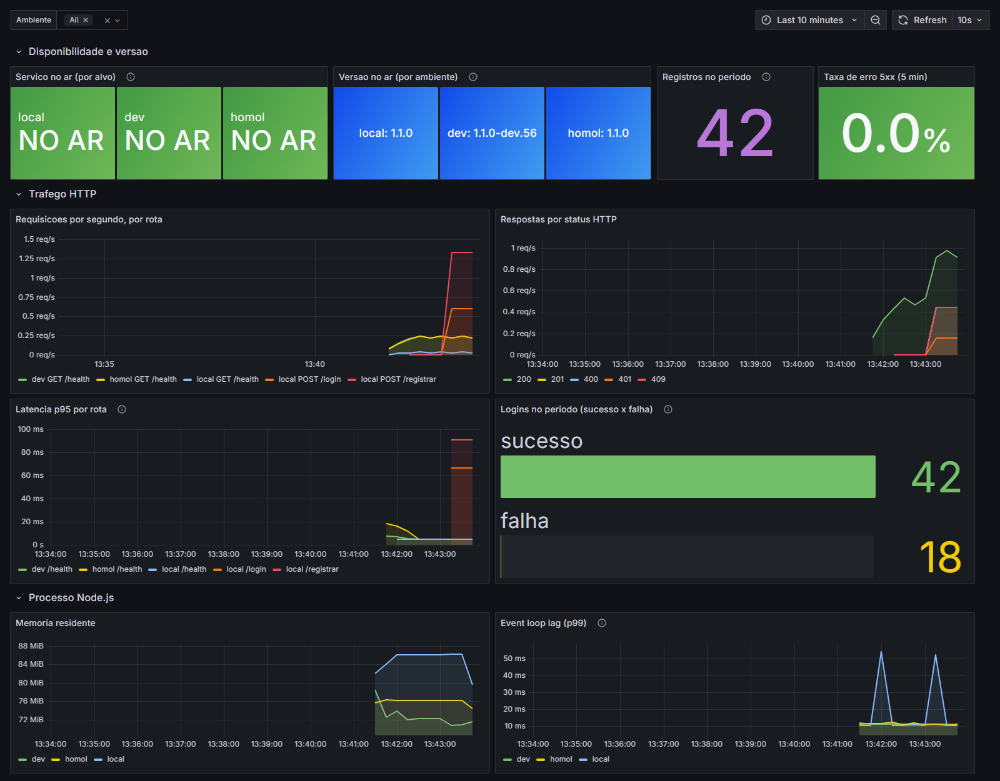

# auth-service

Serviço de autenticação: **registro** de credenciais (e-mail/senha com bcrypt),
**login** e emissão de **JWT** (HS256). Ao registrar, cria o perfil de
leiloeiro ou licitante no `usuarios-service` (`USUARIOS_SERVICE_URL`).
Visão geral do sistema no [README da raiz](../README.md).

## Rodando

Junto com o resto do sistema, a partir da raiz: `docker compose up -d --build`.
Pelo Kong: `POST http://localhost:8000/auth/registrar` e `/auth/login`.

Sozinho, com Prometheus e Grafana: veja [`observabilidade/`](observabilidade/docker-compose.yml).

## Testes

```bash
cd auth-service && npm install && npm test
```

Jest com o repositório mockado (`__mocks__/`), cobrindo `services/` e `utils/`
e o código do T2 (ambiente, métricas, Swagger, migração). Cobertura atual:
**~96%** (mínimo exigido: 50%).

## T2 — CI/CD e Observabilidade

Decisões e funcionamento: **[`docs/T2-DECISOES.md`](docs/T2-DECISOES.md)**.
Checklist das contas (feito junto com o usuarios-service):
**[`../usuarios-service/docs/GUIA-CONFIGURACAO.md`](../usuarios-service/docs/GUIA-CONFIGURACAO.md)**.

| O quê | Onde |
| --- | --- |
| Pipeline (build, testes, SonarCloud, imagem no GHCR, deploy DEV/HOMOL no Render) | `../.github/workflows/auth-service.yml` |
| Versão (Semantic Versioning) | campo `version` do `package.json` |
| Swagger (só DEV) | `GET /docs` e `GET /docs/openapi.json` |
| Métricas Prometheus | `GET /metrics` |
| Health check (versão e ambiente) | `GET /health` |
| Prometheus + Grafana | `observabilidade/` (`docker compose up -d --build`; Grafana em `:3011`) |
| URL DEV / HOMOL | https://auth-service-dev-rslq.onrender.com / https://auth-service-homol-czky.onrender.com (os sufixos `-rslq` e `-czky` foram dados pelo Render) |

**Dashboard do Grafana** (`observabilidade/`, em `http://localhost:3011`, depois do
`gerar-trafego.ps1`): o serviço local e os do Render (DEV e HOMOL) no ar, a versão de cada
ambiente, o tráfego por rota e por status, a latência p95, os registros e os logins
(sucesso x falha).



Variáveis:

| Variável | Uso |
| --- | --- |
| `APP_ENV` | `local`, `dev` ou `homol`; o Swagger só liga em `local`/`dev` |
| `SWAGGER_ENABLED` | opcional: força o Swagger ligado (`true`) ou desligado (`false`) |
| `DATABASE_URL` + `DB_SSL=true` | banco gerenciado (Neon); substitui as `DB_*` |
| `VERSAO_IMAGEM` | gravada pelo pipeline no build da imagem (ex.: `1.1.0-dev.14`) |
| `JWT_SECRET`, `JWT_ISSUER`, `JWT_EXPIRES_IN` | assinatura do token; o segredo é o mesmo em todos os serviços do ambiente |
| `USUARIOS_SERVICE_URL` | onde criar o perfil; vazio = registra só a credencial |
| `CHAVE_INTERNA` | vai no header `X-Chave-Interna` ao criar o perfil (rota interna do usuarios-service); a mesma em todos os serviços do ambiente |

Ao iniciar, o serviço roda `src/db/migrar.js` (cria a tabela se não existir).
