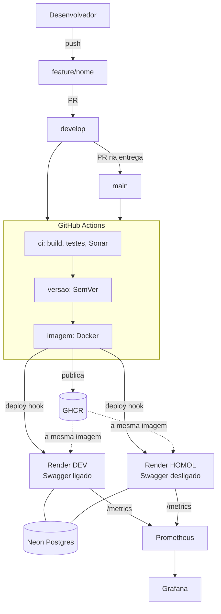
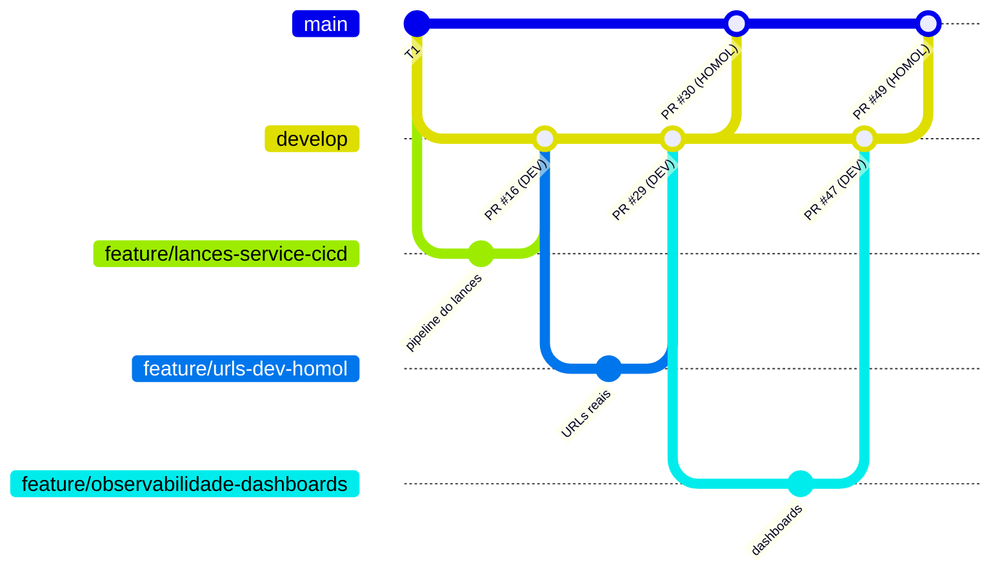
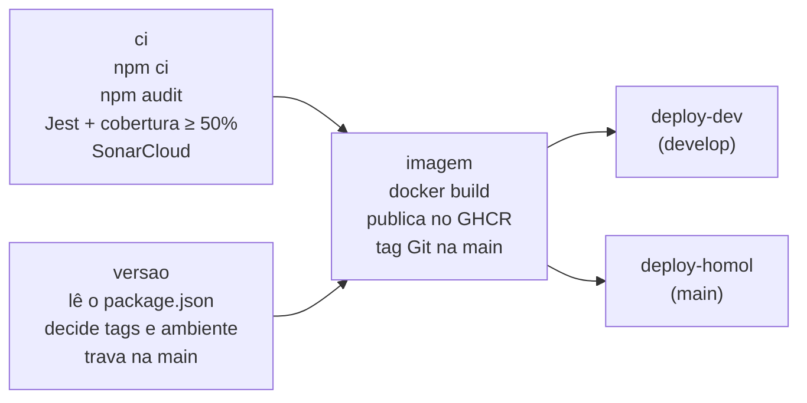
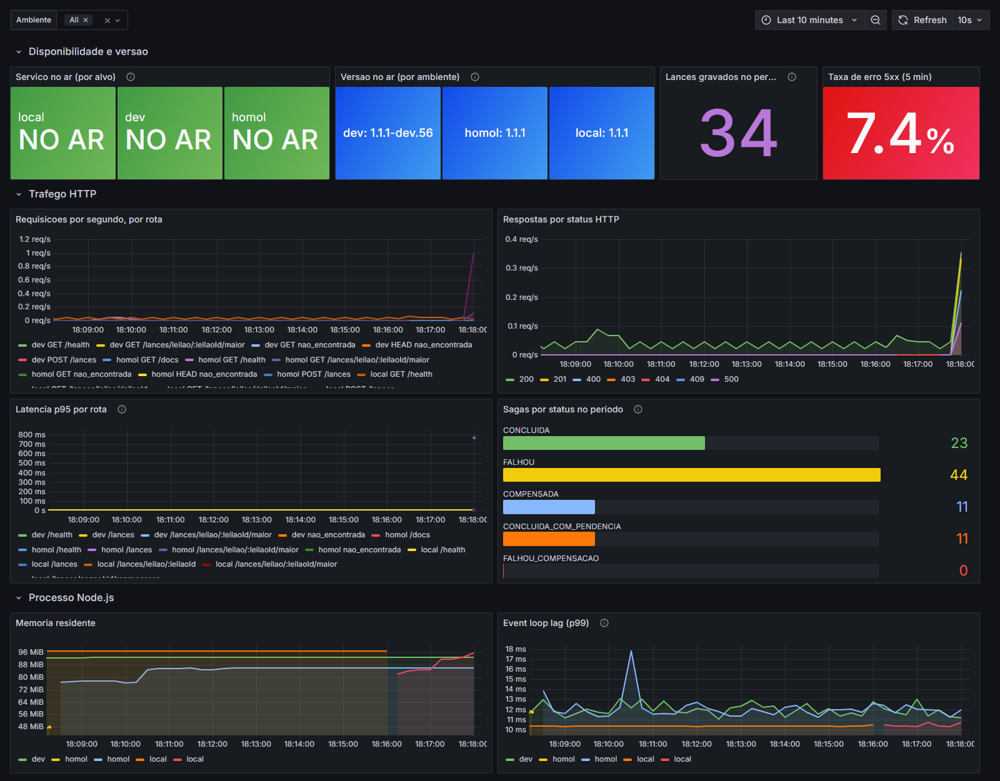

# T2 — CI/CD e Observabilidade: o processo da equipe

> Documento de estudo e de apresentação. Explica **tudo o que a equipe fez no T2**,
> do primeiro pipeline até a entrega em homologação: o que o trabalho pedia, quem
> fez cada parte, como cada peça funciona, os problemas que apareceram e como
> foram resolvidos.
>
> Os detalhes técnicos de cada serviço estão nos documentos de decisões:
> [`leiloes-service`](../leiloes-service/docs/T2-DECISOES.md) (o modelo seguido pelos outros),
> [`auth-service`](../auth-service/docs/T2-DECISOES.md),
> [`usuarios-service`](../usuarios-service/docs/T2-DECISOES.md) e
> [`lances-service`](../lances-service/docs/T2-DECISOES.md).
> A arquitetura do sistema (T1) está em [`ARQUITETURA.md`](ARQUITETURA.md).

---

## 1. Resumo em um minuto

O T1 entregou o **Leilão de Bois**: 4 microsserviços (auth, usuarios, leiloes e
lances), cada um com o próprio banco, atrás de um API Gateway (Kong). O T2 pediu
para colocar esses serviços num **pipeline de CI/CD** e adicionar
**observabilidade**.

O resultado, em números (24/10/2026):

| O quê | Resultado |
|---|---|
| Pipelines | 4, um por serviço, no GitHub Actions; todos verdes na `develop` e na `main` |
| Ambientes na nuvem | 8 serviços no Render: 4 em DEV e 4 em HOMOL |
| Bancos | Neon Postgres, um banco por serviço e por ambiente |
| Entregas na `main` | duas: 20/10 (#30) e 24/10 (#49) |
| Versões publicadas na `main` | auth `1.1.1`, usuarios `1.1.1`, leiloes `1.2.1`, lances `1.1.1` (com tag Git) |
| Testes unitários | 410 (auth 59, usuarios 123, leiloes 112, lances 116), cobertura de linhas entre 85% e 91% |
| Ponta a ponta local (pelo Kong) | 75 passos e a coleção Postman (65 requisições, 98 conferências) |
| Teste integrado na nuvem | 21/21 no DEV e 21/21 no HOMOL, passando pelos 4 serviços |
| Dependabot | 30 PRs abertos pelo robô: 21 juntados e 9 fechados com justificativa |
| Observabilidade | `/metrics` nos 8 serviços; Prometheus + Grafana com um dashboard por serviço, com a captura no README de cada um |

---

## 2. O que o trabalho pedia e como cumprimos

| Item da especificação | Como cumprimos | Onde ver |
|---|---|---|
| 1. Git Flow (`main` = homologação, `develop` = desenvolvimento, `feature/*`) | toda mudança nasce numa `feature/<nome>`, vai por PR para a `develop` e, na entrega, por PR para a `main` | aba *Branches* e *Pull requests* do GitHub |
| 2. CI: build, testes e SonarQube/SonarCloud | job `ci` de cada workflow: `npm ci`, `npm audit`, Jest com cobertura mínima de 50% e análise no SonarCloud | `.github/workflows/*-service.yml` |
| 3. CD: `develop` → DEV, `main` → HOMOL (Render) | jobs `deploy-dev` e `deploy-homol` chamam o Render e só terminam quando a versão nova responde | `<servico>/ci/deploy-render.sh` |
| 4. Swagger habilitado no DEV e desabilitado no HOMOL | a variável `APP_ENV` decide; no HOMOL a rota `/docs` nem é registrada (404) | `src/config/ambiente.js` e `src/app.js` |
| 6. Dockerfile, build automático e publicação da imagem | Dockerfile por serviço; o pipeline constrói em todo push e publica no GitHub Container Registry (GHCR) | `<servico>/Dockerfile`, job `imagem` |
| 7. Semantic Versioning | versão `MAJOR.MINOR.PATCH` no `package.json`; `X.Y.Z-dev.N` no DEV, `X.Y.Z` + tag Git no HOMOL | job `versao` |
| 8. Dependabot e secrets do GitHub | `dependabot.yml` para npm, Docker e Actions; senhas e hooks só em secrets | `.github/dependabot.yml`, *Settings → Environments* |
| 9. Prometheus e Grafana | cada serviço expõe `/metrics`; cada um tem uma pasta `observabilidade/` com Prometheus e Grafana prontos | `<servico>/observabilidade/` |
| 10. 1 microsserviço por aluno, 1 pipeline por serviço | 4 workflows, cada um filtrado pela pasta do seu serviço | filtro `paths:` no início de cada workflow |
| 11. Entregáveis: repositório, pipeline, URLs DEV e HOMOL, dashboards, README | tudo no repositório; URLs na seção 10 deste documento e no README | [`README.md`](../README.md) |

> A especificação pula do item 4 para o 6: não existe item 5.

---

## 3. Quem fez o quê

| Integrante | Serviço | Contribuições principais no T2 |
|---|---|---|
| **Thiago** (`ThiagoSchulze`) | `leiloes-service` | Abriu o caminho: criou a `develop` e o **primeiro pipeline** (leiloes), que virou o modelo dos outros três (workflow, script de deploy, versionamento, Dockerfile, métricas e dashboard). Configurou Neon e Render do leiloes. |
| **Lucas** (`ratzmann`) | `auth-service` e `usuarios-service` | Pipelines, métricas e dashboards do auth e do usuarios (PR #13). Dono e admin do repositório: cadastrou os *Environments*, os secrets (hooks do Render) e as variáveis. Configurou Neon e Render dos dois serviços. |
| **Anderson** (`fkruger-anderson`) | `lances-service` | Pipeline, métricas da Saga e dashboard do lances (PR #16). Integração da revisão do T1 com o T2 (#14), segurança sem o Kong na nuvem (#18 e #21), Node 24 LTS (#20), comentários didáticos (#19 e #22), URLs reais (#29), as correções de observabilidade e os dashboards nos READMEs (#47), as duas entregas `develop` → `main` (#30 e #49, com as versões PATCH do #48), a triagem do Dependabot e os testes integrados na nuvem. Configurou Neon e Render do lances. |

O trabalho de cada um **espelha o do leiloes**: tudo o que é infraestrutura foi
copiado sem mudar a lógica. Assim os quatro pipelines funcionam e se explicam do
mesmo jeito, e cada integrante consegue explicar o do colega.

---

## 4. Visão geral



A ideia central: **o que roda na nuvem é exatamente a imagem que passou nos
testes**. O GitHub constrói e testa, publica a imagem no GHCR e manda o Render
rodar aquela imagem. O Render nunca constrói nada.

---

## 5. Linha do tempo

| Data | O que aconteceu |
|---|---|
| 14/10 | Thiago cria a `develop` e o pipeline do leiloes, que vira o modelo. |
| 15/10 | Lucas entrega auth e usuarios (PR #13). A revisão do T1 entra no T2 (PR #14). |
| 16/10 | Swagger com as regras do T1 e leiloes `1.2.0` (#15); pipeline do lances (#16); `APP_ENV=local` no docker-compose (#17); `jwt.verify` nos serviços (#18); comentários (#19); Node 24 LTS (#20); correções de arquitetura, LGPD do crédito e chave interna (#21); comentários revisados (#22). |
| 17/10 | Regras do Git Flow registradas no `CLAUDE.md` (#23). |
| 18–19/10 | Bancos no Neon e serviços no Render (DEV e HOMOL) de cada integrante; segredos compartilhados configurados nos 8 serviços; os 8 *Environments* do GitHub completos. |
| 20/10 | URLs reais no README (#29); **entrega `develop` → `main`** (#30); deploy em HOMOL confirmado nos 4; teste integrado 21/21 no DEV e no HOMOL; triagem dos 16 PRs que o Dependabot abriu depois da entrega. |
| 24/10 | Correções de observabilidade e dashboards nos READMEs (#47); versões PATCH dos 4 serviços (#48); **segunda entrega `develop` → `main`** (#49): HOMOL com auth, usuarios e lances `1.1.1` e leiloes `1.2.1`; teste integrado 21/21 no DEV e no HOMOL. |

---

## 6. Git Flow



| Branch | Para que serve | O pipeline faz | Ambiente |
|---|---|---|---|
| `feature/<nome>` | uma tarefa (inclusive correções e documentação) | build, testes, Sonar e build da imagem, **sem publicar** | nenhum |
| `develop` | desenvolvimento integrado | tudo acima + publica a imagem + deploy | **DEV** |
| `main` | homologação | tudo acima + trava de versão + tag Git + deploy | **HOMOL** |

Regras que a equipe seguiu:
- toda mudança entra por **Pull Request**, juntado com "Create a merge commit";
- um commit por alteração, com mensagem em português (`feat(lances): ...`, `fix: ...`, `docs: ...`);
- as branches `feature/*` **não são apagadas** depois do merge: ficam no GitHub como evidência do Git Flow;
- os PRs do Dependabot também seguem o fluxo: vão para a `develop` e passam pelo pipeline.

---

## 7. O pipeline, job a job

Cada serviço tem o seu arquivo em `.github/workflows/`. O filtro `paths:` faz o
pipeline rodar **só** quando a pasta daquele serviço muda: um erro no lances não
trava o deploy do auth.



1. **`ci`**: instala exatamente o `package-lock.json` (`npm ci`), roda o
   `npm audit` (falha com vulnerabilidade **crítica** nas dependências de
   produção), roda os testes com cobertura (falha se algum teste falhar ou se a
   cobertura ficar abaixo de 50%), guarda o relatório e manda o código para o
   **SonarCloud** (organização única, um projeto por serviço).
2. **`versao`**: lê a versão do `package.json`, valida o formato `X.Y.Z` e decide
   as tags da imagem e o ambiente de destino. Na `main`, falha se aquela versão
   já foi publicada em outro commit (seção 8).
3. **`imagem`**: só começa se `ci` **e** `versao` passaram. Constrói a imagem e,
   na `develop` ou na `main`, publica no GHCR. Na `main`, cria a tag Git.
4. **`deploy-dev`** ou **`deploy-homol`**: chama o Render e espera a versão nova
   responder (seção 10).

O encadeamento (`needs:`) garante que **nada é publicado nem implantado se um
teste falhar**. Em PRs o pipeline roda tudo, mas não publica nem faz deploy.

---

## 8. Versionamento (Semantic Versioning)

A versão fica no campo `version` do `package.json` de cada serviço, no formato
`MAJOR.MINOR.PATCH`:

| Mudança | Sobe | Exemplo |
|---|---|---|
| quebra quem usa a API | MAJOR | `1.1.0` → `2.0.0` |
| funcionalidade nova compatível (`feat`) | MINOR | `1.1.0` → `1.2.0` (leiloes, com as regras do T1) |
| correção ou atualização de dependência | PATCH | `1.1.0` → `1.1.1` |

| Branch | Tags da imagem | Exemplo |
|---|---|---|
| `develop` | `X.Y.Z-dev.<nº da execução>`, `dev`, `sha-<commit>` | `1.1.1-dev.56` |
| `main` | `X.Y.Z`, `homol`, `latest`, `sha-<commit>` + tag Git `<servico>-vX.Y.Z` | `1.1.1`, `lances-service-v1.1.1` |

- `-dev.N` é uma *pre-release* da SemVer: vem **antes** de `1.1.0` e deixa claro
  que não é versão final.
- **Trava de versão:** se a tag `lances-service-v1.1.0` já existe em outro commit,
  o job `versao` da `main` falha com "suba a versão". Uma versão nunca aponta para
  dois códigos diferentes.
- O prefixo do serviço na tag existe porque o repositório tem 4 serviços, cada
  um com a sua versão.
- **Como subir a versão:** numa `feature/*`, rodar
  `npm version patch --no-git-tag-version` dentro da pasta do serviço (muda o
  `package.json` e o `package-lock.json`) e seguir o Git Flow. A tag Git é o
  pipeline que cria.

---

## 9. Containerização e GHCR

- Um `Dockerfile` por serviço, a partir de `node:24-alpine` (Node 24 é LTS, com
  suporte até 30/04/2028):
  - `npm ci --omit=dev`: build reprodutível e sem dependências de teste;
  - `USER node`: o processo **não roda como root**;
  - `HEALTHCHECK` no `/health`;
  - `ARG VERSAO_IMAGEM`: o pipeline grava a versão completa dentro da imagem, e
    o serviço mostra essa versão no `/health` e nas métricas.
- As imagens vão para `ghcr.io/ratzmann/<servico>`. O login usa o token
  automático do GitHub Actions: não há senha de registro guardada em lugar nenhum.

---

## 10. Deploy no Render e os ambientes

### Como o deploy funciona

Cada serviço tem dois serviços no Render, do tipo **Existing Image** (imagem
pronta do GHCR). O script `ci/deploy-render.sh`:

1. chama o **deploy hook** do Render (uma URL secreta) com
   `imgURL=ghcr.io/ratzmann/<servico>:<versao>`: o Render baixa e roda aquela imagem;
2. faz o **smoke test**: consulta o `/health` a cada 10 s, por até 10 minutos, até
   a resposta trazer a versão nova;
3. se a versão não aparecer, o job falha: o deploy não foi confirmado.

Por que conferir a **versão** e não só "respondeu 200"? Logo depois do hook, a
versão antiga ainda está no ar e também responderia 200. Comparar a versão é a
prova de que a nova subiu.

### Environments do GitHub

Cada ambiente guarda o secret `RENDER_DEPLOY_HOOK_URL` e a variável `RENDER_URL`.
São 8 environments, um por serviço e ambiente:

| Serviço | DEV | HOMOL |
|---|---|---|
| leiloes | `dev` | `homol` |
| auth | `auth-dev` | `auth-homol` |
| usuarios | `usuarios-dev` | `usuarios-homol` |
| lances | `lances-dev` | `lances-homol` |

Os prefixos existem porque o secret tem o mesmo nome em todos: se dois serviços
dividissem o environment, um faria deploy no Render do outro.

### DEV x HOMOL

| | DEV | HOMOL |
|---|---|---|
| Recebe | cada merge na `develop` | cada entrega na `main` |
| Versão | `1.1.1-dev.N` | `1.1.1` |
| Swagger (`/docs`) | ligado | **desligado (404)** |
| Banco | `<servico>_dev` | `<servico>_homol` |
| Segredos (`JWT_SECRET`, `CHAVE_INTERNA`) | um par para os 4 serviços do DEV | outro par para os 4 do HOMOL |
| Falha simulada da Saga | permitida (para demonstrar a compensação) | desligada |

O Swagger depende da variável `APP_ENV`. É **"fail-closed"**: se alguém esquecer
a variável dentro da imagem, o Swagger fica desligado. No HOMOL a rota `/docs`
nem é registrada, então responde o mesmo 404 de qualquer rota inexistente.

### URLs

| Serviço | DEV (`develop`) | HOMOL (`main`) |
|---|---|---|
| auth | https://auth-service-dev-rslq.onrender.com | https://auth-service-homol-czky.onrender.com |
| usuarios | https://usuarios-service-dev.onrender.com | https://usuarios-service-homol.onrender.com |
| leiloes | https://leiloes-service-dev-bnhz.onrender.com | https://leiloes-service-homol-igr9.onrender.com |
| lances | https://lances-service-dev.onrender.com | https://lances-service-homol.onrender.com |

Cada URL responde `/health` (versão e ambiente) e `/metrics`. No plano gratuito,
o serviço "dorme" depois de ~15 min sem uso; a primeira chamada pode levar quase
1 minuto.

### Banco na nuvem (Neon)

- Cada serviço lê a `DATABASE_URL` (com `DB_SSL=true`); sem ela, usa as variáveis
  do docker-compose, como no T1.
- Ao iniciar, o serviço roda `db/migrar.js`: executa o `init.sql` (tudo
  `IF NOT EXISTS`, então pode rodar sempre), com novas tentativas se o banco
  ainda estiver acordando. Só então a porta abre.
- **Um banco por serviço e por ambiente** (*database per service*): testes no DEV
  não sujam a homologação, e nenhum serviço lê o banco de outro.
- A `DATABASE_URL` fica **só no Render**: nunca passa pelo GitHub.

---

## 11. Segurança

### Secrets e menor privilégio

| Segredo | Onde fica |
|---|---|
| `SONAR_TOKEN` | secret do repositório |
| `RENDER_DEPLOY_HOOK_URL` | secret de cada environment (quem tem a URL consegue fazer deploy) |
| `DATABASE_URL`, `JWT_SECRET`, `CHAVE_INTERNA` | só nas variáveis do Render |

- O workflow começa com permissão `contents: read`. Só o job `imagem` ganha
  `packages: write` (publicar a imagem) e `contents: write` (criar a tag Git, o
  que só acontece na `main`).
- Nenhuma senha, hook ou token está no código, nos commits ou nos PRs.

### Na nuvem não há Kong

No docker-compose, o Kong é o único ponto de entrada e confere o token. No
Render, cada serviço tem URL pública própria, sem o Kong na frente. Por isso
três proteções foram levadas para dentro dos serviços:

1. **`jwt.verify`** (PR #18): usuarios, leiloes e lances conferem a assinatura do
   token com o mesmo `JWT_SECRET` do auth. Token inválido ou vencido → `401`.
2. **Chave interna** (PR #21): as rotas internas do usuarios (criar perfil,
   reservar e liberar crédito) exigem o header `X-Chave-Interna`. Sem a chave →
   `403`; sem a `CHAVE_INTERNA` configurada → `500` (rotas internas desligadas,
   nunca abertas).
3. **LGPD do crédito** (PR #21): o resumo de crédito do licitante só aparece para
   o próprio licitante (outro usuário recebe `403`).

Consequência prática: em cada ambiente, os 4 serviços precisam do **mesmo**
`JWT_SECRET`/`JWT_ISSUER` e da **mesma** `CHAVE_INTERNA`. O teste integrado
confere isso de ponta a ponta.

### Dependabot

O `.github/dependabot.yml` vigia, toda segunda-feira, as dependências npm e a
imagem Docker de cada serviço, além das GitHub Actions. Os PRs vão para a
`develop` e passam pelo pipeline como qualquer mudança.

Decisões da triagem (30 PRs):

| Atualização | Decisão | Por quê |
|---|---|---|
| Actions (checkout, setup-node, Docker, Sonar...) | juntadas | sem impacto no código |
| pg, dotenv 18, Jest/supertest, bcryptjs 3 | juntadas | CI verde e testes na nuvem passando (no bcryptjs 3, o login com senha gravada pela versão antiga foi testado) |
| Node 25/26 na imagem | fechadas | o projeto usa só versões **LTS**; o Node 26 só vira LTS em 28/10/2026 |
| Express 5 | fechadas | não adotar a versão nova num serviço só; se o grupo migrar, os 4 juntos |

> O Dependabot lê a configuração da branch padrão (`main`). Por isso os PRs de
> auth, usuarios e lances só apareceram depois da entrega de 20/10.

---

## 12. Observabilidade

### Métricas no serviço (`/metrics`)

Cada serviço usa o `prom-client` e expõe:

- **tráfego HTTP**: requisições por método, rota e status, e a duração (latência);
- **processo Node.js**: CPU, memória, event loop;
- **métricas de negócio**, próprias de cada serviço:

| Serviço | Métrica de negócio | O que mostra |
|---|---|---|
| auth | `auth_registros_total`, `auth_logins_total{resultado}` | registros por papel; logins com sucesso x falha |
| usuarios | `usuarios_cadastros_total`, `usuarios_reservas_credito_total{operacao}` | cadastros; crédito reservado e liberado pela Saga |
| leiloes | `leiloes_cadastrados_total`, `leiloes_mudancas_status_total{status}` | leilões criados; ciclo de vida (aberto, encerrado, cancelado) |
| lances | `lances_registrados_total`, `lances_sagas_total{status}` | lances gravados; sagas concluídas, compensadas ou com pendência |

Cuidados:
- todas as métricas levam os rótulos `service`, `ambiente` e `versao`: o Grafana
  mostra qual versão está em qual ambiente;
- o rótulo `rota` usa o **padrão** da rota (`/lances/:id`), nunca a URL real
  (`/lances/42`): com a URL real, cada id criaria uma série nova no Prometheus
  (problema de **cardinalidade**);
- os contadores de negócio só somam **depois** que a operação foi gravada;
- as séries de negócio já nascem com zero para cada valor conhecido do rótulo
  (`comecarEmZero`, PR #47). Sem isso, o `increase()` do Prometheus não conta o
  primeiro incremento de uma série nova, e os painéis "no período" mostrariam 0
  num serviço recém-iniciado.

### Prometheus e Grafana

Cada serviço tem uma pasta `observabilidade/` com um `docker-compose` que sobe o
Prometheus e o Grafana já configurados (datasource e dashboard provisionados:
sobe pronto, sem clicar em nada). O Prometheus lê o serviço local e as URLs de
DEV e HOMOL no Render a cada 15 s.

| Stack | Prometheus | Grafana |
|---|---|---|
| leiloes | `:9090` | `:3000` |
| auth | `:9091` | `:3011` |
| usuarios | `:9092` | `:3012` |
| lances | `:9093` | `:3013` |

Com portas diferentes, as quatro stacks sobem juntas. O lances é o único que
precisa do sistema completo no ar (a Saga chama o leiloes e o usuarios).

Os quatro dashboards têm a mesma estrutura:
- **disponibilidade e versão**: serviço no ar por alvo e versão no ar por ambiente;
- **tráfego HTTP**: requisições por rota, respostas por status, latência p95,
  taxa de erro 5xx;
- **negócio**: registros e logins (auth), cadastros e operações de crédito
  (usuarios), leilões e mudanças de status (leiloes), lances e sagas por status (lances);
- **processo Node.js**: memória e atraso do event loop.

O script `gerar-trafego.ps1` de cada pasta movimenta os gráficos para a
demonstração. O README de cada serviço mostra uma captura do seu dashboard com
dados reais (`<servico>/docs/dashboard-grafana.png`). Abaixo, o do lances: os três
alvos no ar, a versão de cada ambiente, o tráfego e as sagas por status final (os
5xx são a falha simulada que o script usa para mostrar a compensação).



---

## 13. Testes e verificação

| Nível | O que é | Resultado |
|---|---|---|
| Unitários (Jest) | regras, rotas, clients e o código do T2, com bancos e serviços simulados | 410 testes; cobertura mínima de 50% garantida pelo pipeline |
| Ponta a ponta local | `testes/testar-tudo.ps1`, pelo Kong, com a stack do docker-compose | 75 passos |
| Postman | `testes/leilao-microservicos.postman_collection.json` | 65 requisições, 98 conferências |
| Smoke test do deploy | o pipeline espera a versão nova no `/health` | em todo deploy de DEV e HOMOL |
| **Teste integrado na nuvem** (`testes/testar-nuvem.js`) | registro, login, leilão, dois lances pela Saga, recusa do lance baixo, LGPD do crédito e cancelamento devolvendo o crédito | **21/21 no DEV e 21/21 no HOMOL** |

O teste integrado na nuvem é o que prova que os 4 serviços conversam no Render:
o auth cria o perfil no usuarios com a chave interna, o leiloes valida o
leiloeiro, o lances orquestra a Saga com o leiloes e o usuarios, e o
cancelamento libera as reservas.

---

## 14. Problemas que apareceram e como foram resolvidos

| Problema | Causa | Solução | Lição |
|---|---|---|---|
| Node 20 saindo de suporte | fim do suporte em 30/04/2026 | migração dos 4 serviços para o Node 24 LTS (PR #20) | usar só versões LTS (pares) |
| Dependabot sugerindo Node 25 e 26 | ele sugere a versão mais nova, LTS ou não | PRs fechados com justificativa | o robô sugere; a equipe decide |
| Um serviço fazendo deploy no outro | os environments `dev`/`homol` eram do leiloes | environments com prefixo (`auth-dev`, `lances-homol`...) | cada pipeline com os seus segredos |
| Serviços abertos sem o Kong | na nuvem cada serviço tem URL pública | `jwt.verify`, chave interna e LGPD do crédito (seção 11) | não confiar só no gateway |
| URLs do leiloes mudaram | o serviço foi recriado no Render e ganhou sufixo (`-bnhz`, `-igr9`) | URLs atualizadas no README, no Prometheus e nas variáveis dos outros serviços (PR #29) | URL sempre em variável, nunca fixa no código |
| HOMOL criado antes da primeira entrega | a imagem `:homol` ainda não existia | HOMOL criado com a imagem `:dev`; o primeiro deploy da `main` trocou pela versão certa, e depois a Image URL foi trocada para `:homol` | o hook com `imgURL` decide a imagem de cada deploy |
| Deploy HOMOL do leiloes falhando (`curl: (3) Malformed input`) | o secret do hook foi salvo com espaço ou quebra de linha | secret salvo de novo, só com a URL | colar segredos sem nada antes ou depois |
| Depois, o mesmo deploy dava `404` | o hook era do serviço antigo, já apagado | hook do serviço atual; job refeito ("Re-run failed jobs") e "Deploy confirmado" | conferir o `srv-...` do hook com o painel do serviço |
| Teste integrado do DEV falhou uma vez | o banco do leiloes DEV recomeçou os ids, e o lances ainda tinha lances antigos com o mesmo id de leilão | os ids novos não colidem mais; o leilão afetado foi cancelado | recriar o banco de um serviço afeta os dados de quem guarda referência a ele |
| Primeira chamada demorando | o plano gratuito do Render "dorme" | o smoke test espera até 10 min; abrir os `/health` antes de apresentar | — |
| Dashboard local do leiloes com 0 leilões e ~40% de erros 500 | a stack de observabilidade do leiloes ficou sem `JWT_SECRET` depois do `jwt.verify` | `JWT_SECRET` e `JWT_ISSUER` na stack (PR #47) | a configuração de demonstração precisa acompanhar as mudanças de segurança |
| Painéis "no período" zerados num serviço recém-iniciado | o `increase()` do Prometheus não conta o primeiro incremento de uma série nova | séries de negócio que já nascem com zero (PR #47) | entender como o Prometheus calcula antes de confiar no gráfico |

---

## 15. Como mostrar e testar o que foi feito

Roteiro para a apresentação e para quem quiser conferir sozinho. Cada item diz
**onde** mostrar, **o que** clicar ou rodar e **o que deve aparecer**. As respostas
citadas são as reais, conferidas em 24/10/2026.

- Os comandos `bash` rodam no **Git Bash** (Windows), no Linux ou no macOS, na raiz
  do repositório. Os `powershell` rodam no PowerShell do Windows.
- Os exemplos usam o **lances**. Para mostrar outro serviço, troque `lances` pelo
  nome dele e use a URL da tabela da seção 10.
- As regras de negócio do T1 (local, pelo Kong) têm roteiros próprios por pessoa:
  `testes/TESTE ANDERSON.md`, `testes/TESTE LUCAS.md` e `testes/TESTE THIAGO.md`.

### 15.1 Antes de começar (uns 10 minutos antes)

1. **Acordar os 8 serviços.** No plano gratuito do Render, um serviço parado
   "dorme" depois de ~15 min, e a primeira chamada leva quase 1 minuto:

   ```bash
   for u in auth-service-dev-rslq usuarios-service-dev leiloes-service-dev-bnhz lances-service-dev auth-service-homol-czky usuarios-service-homol leiloes-service-homol-igr9 lances-service-homol; do curl -s https://$u.onrender.com/health; echo; done
   ```

   Esperado: 8 linhas `{"status":"ok",...}`. As 4 do DEV terminam com
   `"ambiente":"dev"` e versão `1.1.1-dev.N` (leiloes: `1.2.1-dev.N`); as 4 do
   HOMOL, com `"ambiente":"homol"` e versão `1.1.1` (leiloes: `1.2.1`).
2. **Entrar no GitHub** no navegador: a aba *Actions* só mostra os logs para quem
   está logado.
3. **Se for mostrar o Grafana ao vivo:** abrir o Docker Desktop e subir as stacks
   com antecedência (seção 15.10). Subir leva alguns minutos.

### 15.2 Item 1 — Git Flow

- **Onde:** https://github.com/ratzmann/API-Leiloes/branches
- **Mostrar:**
  1. as branches `main` (HOMOL), `develop` (DEV) e as `feature/*`, que não foram
     apagadas depois do merge;
  2. em *Pull requests* → *Closed*, um PR de feature para a `develop`, por exemplo
     o #47 (`feature/observabilidade-dashboards`);
  3. o PR de entrega da `develop` para a `main`, o #49 (o primeiro foi o #30).
- **Esperado:** cada PR aparece como *Merged*, juntado com "Create a merge
  commit", e com os checks verdes.
- **No terminal:**

  ```bash
  git fetch origin
  git log --oneline --first-parent origin/main -2
  ```

  Esperado: `Merge pull request #49 from ratzmann/develop` e
  `Merge pull request #30 from ratzmann/develop`.

### 15.3 Item 2 — CI: build, testes e SonarCloud

- **Onde:** aba *Actions* → workflow `lances-service` (lista à esquerda) → o run
  com o título do PR #49, na branch `main`.
- **Mostrar:**
  1. o grafo dos jobs: `Build, testes e SonarCloud` e `Versao` em paralelo,
     depois `Imagem Docker` e `Deploy HOMOL`;
  2. dentro de *Build, testes e SonarCloud*, os passos `npm ci`, `npm audit`,
     `npm test` (procure a linha `Tests: 116 passed, 116 total`) e
     `Analise SonarCloud`.
- **SonarCloud:**
  https://sonarcloud.io/project/overview?id=devopsleiloes_lances-service
  (os outros projetos: `devopsleiloes_auth-service`, `devopsleiloes_usuarios-service`
  e `devopsleiloes_leiloes-service`). Mostrar o *Quality Gate* e a cobertura.
- **No terminal**, os testes unitários dos 4 serviços:

  ```powershell
  powershell -ExecutionPolicy Bypass -File .\testes\testar-unitarios.ps1
  ```

  Esperado: a tabela *RESUMO* com 59 (auth), 123 (usuarios), 112 (leiloes) e
  116 (lances) testes, e a frase "Todos os servicos passaram".

### 15.4 Item 3 — CD: `develop` → DEV e `main` → HOMOL

- **Onde:** no mesmo run da `main`, abrir o job *Deploy HOMOL (Render)* e o passo
  *Deploy da imagem e smoke test*.
- **Esperado no log:**

  ```
  Disparando deploy de ghcr.io/ratzmann/lances-service:1.1.1
  tentativa 1: versao no ar = ... (esperada 1.1.1)
  Deploy confirmado: https://lances-service-homol.onrender.com esta com a versao 1.1.1
  ```

  Num run da `develop`, o job é *Deploy DEV (Render)* e a versão é `1.1.1-dev.N`.
- **Ambientes:** na página inicial do repositório, barra lateral direita,
  *Deployments*: os 8 environments (`dev`, `homol`, `auth-dev`, `auth-homol`,
  `usuarios-dev`, `usuarios-homol`, `lances-dev`, `lances-homol`) com o último deploy.
- **Ao vivo (opcional, ~4 minutos):** *Actions* → `lances-service` →
  *Run workflow* → branch `develop` → *Run workflow*. Quando o run terminar, o
  `/health` do DEV mostra um número `-dev.N` maior que o de antes:

  ```bash
  curl -s https://lances-service-dev.onrender.com/health
  ```

### 15.5 Item 4 — Swagger no DEV, desligado no HOMOL

- **DEV:** abrir https://lances-service-dev.onrender.com/docs no navegador.
  Esperado: o Swagger UI do lances, com as rotas (`POST /lances`, `GET /lances/{id}`...).
- **HOMOL:** abrir https://lances-service-homol.onrender.com/docs. Esperado:
  `{"erro":"Rota nao encontrada."}`, com HTTP 404.
- **No terminal:**

  ```bash
  curl -s -L -o /dev/null -w "DEV: %{http_code}\n" https://lances-service-dev.onrender.com/docs
  curl -s -w " [HOMOL: %{http_code}]\n" https://lances-service-homol.onrender.com/docs
  ```

  Esperado: `DEV: 200` e `{"erro":"Rota nao encontrada."} [HOMOL: 404]`.
- **Explicar:** é a mesma imagem nos dois ambientes; muda só a variável `APP_ENV`
  no Render. No HOMOL a rota `/docs` nem é registrada.

### 15.6 Item 6 — Dockerfile, build e publicação da imagem

- **Onde:** https://github.com/users/ratzmann/packages/container/package/lances-service
  (ou *Packages*, na barra lateral do repositório).
- **Esperado:** as tags `1.1.1`, `homol`, `latest`, `1.1.1-dev.N`, `dev` e `sha-...`.
- **Mostrar** o `lances-service/Dockerfile` (`node:24-alpine`, `npm ci --omit=dev`,
  `USER node`, `HEALTHCHECK`, `ARG VERSAO_IMAGEM`).
- **No terminal** (com o Docker aberto), a imagem publicada pelo pipeline:

  ```bash
  docker run --rm --entrypoint id ghcr.io/ratzmann/lances-service:1.1.1
  docker run --rm --entrypoint sh ghcr.io/ratzmann/lances-service:1.1.1 -c 'echo $VERSAO_IMAGEM'
  ```

  Esperado: `uid=1000(node) gid=1000(node) ...` (o processo não roda como root) e
  `1.1.1` (a versão que o pipeline gravou na imagem).

### 15.7 Item 7 — Semantic Versioning

- **Onde:** https://github.com/ratzmann/API-Leiloes/tags
- **Esperado:** `auth-service-v1.1.0` e `-v1.1.1`, `usuarios-service-v1.1.0` e
  `-v1.1.1`, `leiloes-service-v1.1.0`, `-v1.2.0` e `-v1.2.1`, `lances-service-v1.1.0`
  e `-v1.1.1`.
- **No terminal:**

  ```bash
  git fetch origin --tags
  git tag -l "*-service-v*"
  ```

- **Mostrar** o campo `version` do `lances-service/package.json` e o PR #48, que
  subiu o PATCH dos quatro serviços, um commit por serviço.
- **Explicar a trava:** no job `versao`, se a tag da versão já existe em outro
  commit, a `main` falha com "suba a versão". Por isso o #48 veio antes do #49.

### 15.8 Item 8 — Dependabot, secrets e as proteções sem o Kong

- **Dependabot:**
  https://github.com/ratzmann/API-Leiloes/pulls?q=is%3Apr+author%3Aapp%2Fdependabot
  - Esperado: 30 PRs, sendo 21 juntados e 9 fechados, cada fechado com um
    comentário explicando o motivo (por exemplo, o #26 do Node 26 e o #8 do Express 5).
  - Mostrar também o `.github/dependabot.yml`.
- **Secrets:** mostrar no `.github/workflows/lances-service.yml` o uso de
  `secrets.RENDER_DEPLOY_HOOK_URL` e `secrets.SONAR_TOKEN`. Os valores só o admin
  vê, em *Settings* → *Environments*. Conferir que não há segredo no código:

  ```bash
  git grep -n -E "api.render.com/deploy|npg_" || echo "nenhum segredo no codigo"
  ```

  Esperado: `nenhum segredo no codigo`.
- **Proteções dentro dos serviços** (na nuvem não há Kong):

  ```bash
  curl -s -w " [%{http_code}]\n" -H "Authorization: Bearer token-falso" https://leiloes-service-dev-bnhz.onrender.com/leiloes
  curl -s -w " [%{http_code}]\n" https://usuarios-service-dev.onrender.com/licitantes/1/reservas
  curl -s -w " [%{http_code}]\n" https://usuarios-service-dev.onrender.com/licitantes/1/credito
  ```

  | Comando | Resposta esperada | O que prova |
  |---|---|---|
  | token falso no leiloes | `{"erro":"Token invalido ou expirado."} [401]` | `jwt.verify`: o serviço confere a assinatura |
  | rota interna sem a chave | `{"erro":"Rota interna: so os servicos do sistema podem chamar."} [403]` | a chave interna (`X-Chave-Interna`) |
  | crédito sem login | `{"erro":"Faca login para consultar o credito."} [401]` | LGPD do crédito |

  O `403` do crédito de **outro** licitante aparece no teste integrado (seção
  15.12, passo 6).

### 15.9 Item 9 — Métricas no ar (`/metrics`)

- **No terminal:**

  ```bash
  curl -s https://lances-service-homol.onrender.com/metrics | grep "^lances_sagas_total"
  ```

  Esperado: uma linha por status (`CONCLUIDA`, `CONCLUIDA_COM_PENDENCIA`, `FALHOU`,
  `COMPENSADA`, `FALHOU_COMPENSACAO`), com `ambiente="homol"` e `versao="1.1.1"`.
  As séries já existem com 0 desde a subida do serviço.
- Nos outros serviços: `auth_logins_total`, `usuarios_reservas_credito_total` e
  `leiloes_mudancas_status_total`.

### 15.10 Item 9 — Dashboards no Grafana (ao vivo, na máquina)

1. **Abrir o Docker Desktop** e esperar o motor ficar pronto.
2. **Subir a stack** do serviço:
   - auth, usuarios ou leiloes (cada stack traz uma cópia do serviço e um banco):

     ```bash
     docker compose -f leiloes-service/observabilidade/docker-compose.yml up -d --build
     ```

   - lances (a Saga precisa dos outros serviços): primeiro o sistema completo,
     depois a stack:

     ```bash
     docker compose up -d --build
     docker compose -f lances-service/observabilidade/docker-compose.yml up -d
     ```

3. **Gerar tráfego duas vezes.** O Prometheus lê a cada 15 s, e os gráficos de
   tráfego precisam de duas leituras:

   ```powershell
   powershell -ExecutionPolicy Bypass -File .\lances-service\observabilidade\gerar-trafego.ps1
   powershell -ExecutionPolicy Bypass -File .\lances-service\observabilidade\gerar-trafego.ps1
   ```

4. **Abrir o Grafana**, que entra sem login, só para leitura:

   | Serviço | Grafana | Prometheus |
   |---|---|---|
   | leiloes | http://localhost:3000 | http://localhost:9090 |
   | auth | http://localhost:3011 | http://localhost:9091 |
   | usuarios | http://localhost:3012 | http://localhost:9092 |
   | lances | http://localhost:3013 | http://localhost:9093 |

5. **Esperado no dashboard:**
   - *Serviço no ar*: `local`, `dev` e `homol` como "NO AR" (o Prometheus local lê
     também o Render);
   - *Versão no ar*: a versão de cada ambiente;
   - tráfego por rota e por status, latência p95;
   - os painéis de negócio (no lances, *Sagas por status*: concluídas, falhas,
     compensadas e com pendência).

   No lances, os 5xx são de propósito: o script simula uma falha ao gravar o lance
   para mostrar a compensação.
6. **Sem tempo para subir?** Mostre a captura no README de cada serviço
   (`<servico>/docs/dashboard-grafana.png`).
7. **Depois:** desligar com `docker compose -f <arquivo> down`, **sem** `-v`, para
   não apagar os dados.

### 15.11 Item 10 — Um pipeline por serviço

- **Mostrar** os 4 arquivos em `.github/workflows/` e, no início de cada um, o
  filtro `paths:` (no lances, `lances-service/**`).
- **Prova:** na aba *Actions*, um commit que só mudou o lances roda só o workflow
  `lances-service`. Por exemplo, os PRs #37, #41 e #44 do Dependabot.

### 15.12 Teste integrado na nuvem (os 4 serviços conversando)

```bash
node testes/testar-nuvem.js dev
node testes/testar-nuvem.js homol
```

- **Esperado:** 21 linhas `[OK]` e, no fim, `Resultado: TUDO OK` (código de
  saída 0). Leva uns 2 minutos, porque o leilão criado só começa a aceitar lances
  depois de ~1 minuto.
- **O que cada passo prova:**

  | Passo | Prova |
  |---|---|
  | 0 | os 4 serviços no ar, com a versão e o ambiente certos |
  | 1 | o auth cria o perfil no usuarios pela rota interna, com a chave |
  | 2 | o login confere a senha e devolve o token |
  | 3 | o leiloes valida o leiloeiro no usuarios; o leilão abre |
  | 4 | a Saga do lances reserva o crédito no usuarios e grava o lance |
  | 5 | quando B cobre o lance, a Saga devolve o crédito de A |
  | 6 | regra do incremento (400) e LGPD do crédito (403) |
  | 7 | cancelar o leilão libera as reservas no usuarios |

- Cada execução cria dados de teste novos (e-mails `@teste-dev.com` ou
  `@teste-homol.com`) e cancela o leilão no fim.

### 15.13 Testes locais, pelo Kong

Com o sistema completo no ar (`docker compose up -d --build`):

```powershell
powershell -ExecutionPolicy Bypass -File .\testes\testar-tudo.ps1
```

Esperado: os 75 passos com OK. A coleção do Postman, pelo newman:

```powershell
docker run --rm -v "${PWD}/testes:/etc/newman" postman/newman:alpine run leilao-microservicos.postman_collection.json --env-var base_url=http://host.docker.internal:8000
```

Esperado: 65 requisições e 98 conferências, sem falhas.

### 15.14 Item 11 — Conferência final dos entregáveis

| Entregável | Onde mostrar |
|---|---|
| Repositório | https://github.com/ratzmann/API-Leiloes |
| Pipeline funcional | *Actions*: os 4 workflows verdes na `develop` e na `main` (15.3 e 15.4) |
| URLs DEV e HOMOL | seção 10 deste documento e o README da raiz |
| Dashboards de métricas | README de cada serviço e o Grafana local (15.10) |
| README | `README.md`, os READMEs dos serviços e este documento |

### 15.15 Se algo der errado na hora

| Sintoma | O que fazer |
|---|---|
| `/health` demora ou responde 502/503 | o serviço estava dormindo: espere ~1 minuto e repita |
| o teste integrado falha no passo 0 | acorde os 8 serviços (15.1) e rode de novo |
| o Grafana mostra os painéis de tráfego vazios | rode o `gerar-trafego.ps1` mais uma vez |
| o dashboard do lances só mostra erros | suba o sistema completo da raiz antes da stack do lances |
| `docker` não responde | abra o Docker Desktop e espere o motor ficar pronto |
| a porta já está em uso ao subir uma stack | outra stack ou programa usa a porta: desligue-o ou use a stack de outro serviço |

---

## 16. Glossário

| Termo | Significado |
|---|---|
| **CI** (integração contínua) | a cada push, o código é construído e testado automaticamente |
| **CD** (entrega/implantação contínua) | o código aprovado vai sozinho para um ambiente |
| **Pipeline / workflow** | a sequência de jobs que o GitHub Actions executa |
| **DEV / HOMOL** | ambiente de desenvolvimento / de homologação (simula produção) |
| **Deploy hook** | URL secreta do Render que dispara um deploy |
| **Smoke test** | teste rápido depois do deploy para ver se a versão nova está de pé |
| **GHCR** | GitHub Container Registry, onde ficam as imagens Docker |
| **SemVer** | Semantic Versioning: `MAJOR.MINOR.PATCH` |
| **LTS** | *Long Term Support*: versão do Node com suporte longo (as pares) |
| **SonarCloud** | análise de qualidade do código (bugs, *code smells*, cobertura) |
| **Dependabot** | robô do GitHub que abre PRs atualizando dependências |
| **Environment / secret** | grupo de configurações do GitHub / valor guardado criptografado |
| **Prometheus** | coleta e guarda as métricas lendo o `/metrics` de tempos em tempos |
| **Grafana** | mostra as métricas do Prometheus em gráficos (dashboards) |
| **Cardinalidade** | quantas séries diferentes uma métrica gera; precisa ser limitada |
| **Saga** | sequência de passos entre serviços com compensação se algum falhar (T1) |
